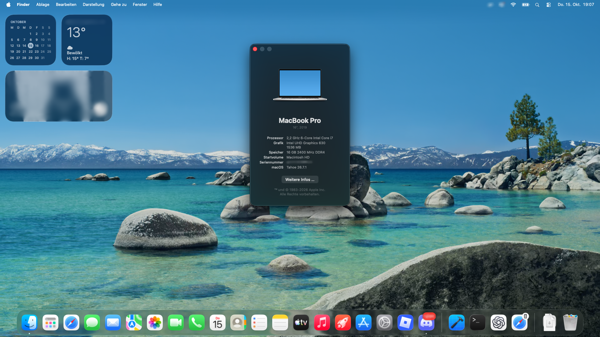

# ASUS UX550GDX - OpenCore for macOS Tahoe

EFI and setup documentation for the **ASUS ZenBook Pro 15 UX550GDX / UX580GD**, with Core i7-8750H, Intel UHD 630 and Intel Wireless-AC 9560.

| Tested installation | Version |
|---|---|
| macOS | Tahoe 26.7.1 (25G241) |
| OpenCore | 1.0.8 RELEASE |
| ASUS firmware | UX550GDX.312 |
| SMBIOS | MacBookPro16,1 |

  

## Download and setup

**[Download the complete EFI](https://github.com/UISize/ASUS-UX550GDX-Hackintosh/releases/download/v0.1.0/EFI-UX550GDX-Tahoe-20261017.zip)**

The archive contains only `EFI/`, including OpenCore, drivers, kexts, ACPI tables, OpenCanopy resources and a single `EFI/OC/config.plist`. **Enter your own SMBIOS identifiers before use.** Tested: this exact package booted successfully from USB on the test laptop with the owner's SMBIOS values (17 October 2026).

1. Match your hardware against [Hardware](Docs/Hardware.md) and apply the [firmware settings](Docs/Firmware.md).
2. Extract the archive, generate your own identifiers and follow [Installation](Docs/Installation.md).
3. Test from a separate boot medium before replacing a working EFI.

## Working features

- macOS boot, Windows dual boot, restart and shutdown.
- Intel UHD 630 acceleration, including practical 3D testing; internal display and brightness control.
- Keyboard backlight, trackpad gestures and **Fn+F6 trackpad toggle**.
- Speakers, headphone output, microphone, webcam and battery indication.
- Wi-Fi, including location services and automatic time zone.
- Bluetooth headphones: pairing, music playback and operation after sleep/wake and shutdown/startup.
- Normal sleep, lid behavior and SD read/eject/reinsert after sleep.
- Hibernation, including automatic sleep-to-hibernate. Settings and test details: [Hibernation](Docs/Hibernation.md).
- Both right-side USB-A ports (USB 2 and USB 3 in macOS).

## Known limitations

| Feature | Status |
|---|---|
| USB-C 3 / SuperSpeed | Not tested (no USB 3 device available for these ports). The included map enables USB 2 only on USB-C. |
| Thunderbolt and USB-C display output | Untested |
| GTX 1050, HDMI and ScreenPad display | Unsupported in this configuration |
| AirDrop | Unsupported by the selected Intel Wi-Fi fork |
| FileVault | Untested |

See [Compatibility](Docs/Compatibility.md) for the complete status.

## Documentation

| Topic | Guide |
|---|---|
| Hardware and UEFI | [Hardware](Docs/Hardware.md), [Firmware](Docs/Firmware.md) |
| Setup | [Installation](Docs/Installation.md) |
| Configuration details | [OpenCore settings](Docs/Configuration.md), [ACPI and patches](Docs/ACPI-and-Patches.md), [USB map](Docs/USB.md) |
| Optional picker names | [Customization](Docs/Configuration.md#optional-customize-picker-names) |
| Sleep and hibernation | [Hibernation](Docs/Hibernation.md) |
| Components and versions | [Dependencies](Docs/Dependencies.md) |
| Support and updates | [Troubleshooting](Docs/Troubleshooting.md), [Recovery and maintenance](Docs/Recovery-and-Maintenance.md) |

The repository also includes a readable [configuration template](EFI/OC/config.template.plist), [ACPI sources](ACPI/Sources) and the reference USB map. The complete runtime EFI is in the download archive.

## Credits and license

Based on OpenCore/Acidanthera, Dortania, SSDTTime, AsusSMC, Voodoo drivers, USBToolBox, OpenIntelWireless and the credited forks. See [Third-party notices](Docs/Third-Party-Notices.md).

This project was developed with the help of OpenAI Codex and tested on one laptop. Original project material uses the [MIT License](LICENSE); upstream components retain their own terms. See [license scope](NOTICE.md) and [Contributing](CONTRIBUTING.md).

## Disclaimer

Use at your own risk. This EFI was tested on one laptop only. Back up your disks and current EFI first. This project is not affiliated with Apple or ASUS.
